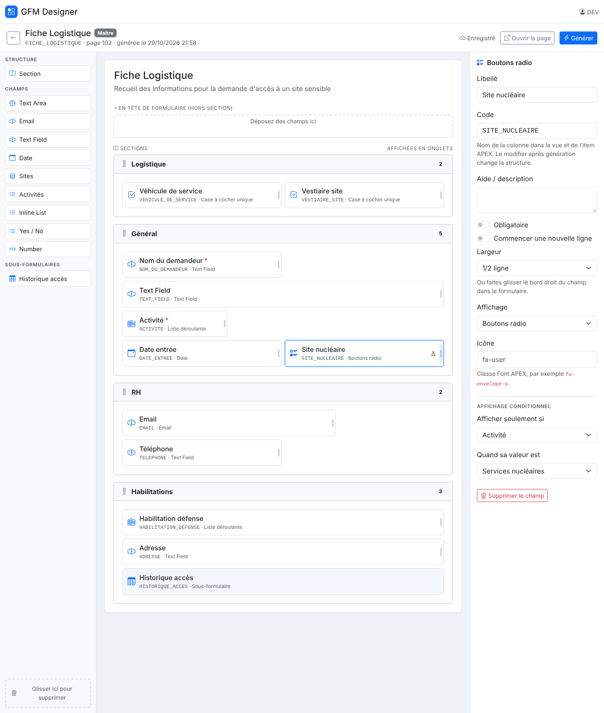

# GFM Designer

Concepteur de formulaires GFM en glisser-déposer, hors d'Oracle APEX : un client JavaScript/Bootstrap et une API REST ORDS, sur les tables et le package `gfm_builder` existants. Version 1.1 : écran Composants et listes de valeurs.

- `client/` : application web (Bootstrap 5, SortableJS, modules ES, sans build)
- `db/` : `gfm_api` (API JSON en PL/SQL), module ORDS, sécurité OAuth2, `gfm_builder` v2.2, `update_v1.1.sql`
- `dev/mock-server.mjs` : la même API en mémoire, pour développer sans base (`node dev/mock-server.mjs`)
- `ARCHITECTURE.md` : architecture, contrat d'API, sécurité, installation, limites
